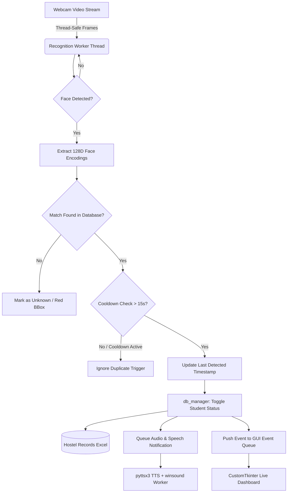

# GateGuard AI - Intelligent Biometric Gate Pass & Movement Tracker

[](https://www.python.org/)
[](https://opencv.org/)
[](https://github.com/TomSchimansky/CustomTkinter)
[](LICENSE)

An automated, contactless biometric entry/exit monitoring system engineered for hostels, educational institutions, and gated premises. **GateGuard AI** replaces manual paper sign-in registers with high-accuracy facial recognition, automated direction toggling (IN/OUT), real-time text-to-speech audio alerts, and automated multi-sheet Excel ledger logging.

---

## Table of Contents

- [Overview](#overview)
- [Key Features](#key-features)
- [System Architecture](#system-architecture)
- [Workflow & Logic Flowchart](#workflow--logic-flowchart)
- [Project Structure](#project-structure)
- [Prerequisites & Dependencies](#prerequisites--dependencies)
- [Installation & Setup](#installation--setup)
- [Running the Application](#running-the-application)
- [Database Schema (Excel Ledger)](#database-schema-excel-ledger)
- [Verification & Diagnostics](#verification--diagnostics)
- [Troubleshooting](#troubleshooting)
- [License & Credits](#license--credits)

---

## Overview

Traditional hostel and gate attendance relies on security guards maintaining physical record books, which are slow, error-prone, and susceptible to proxy signing. 

**GateGuard AI** addresses this challenge by running a multi-threaded desktop gatekeeper application:
1. Continuous video stream captures moving individuals.
2. 128-dimensional deep face embeddings are extracted using dlib/ResNet.
3. Faces are matched against pre-registered biometric profiles at a strict tolerance threshold (0.50).
4. System automatically toggles the individual's location status (`INSIDE` ⇄ `ONLY_OUTSIDE`).
5. Real-time auditory confirmation (friendly chime + localized Text-to-Speech greeting) informs the user of their status.
6. The event is permanently logged with timestamps to an organized Excel workbook with thread-safe locking.

---

## Key Features

- **Real-Time Facial Recognition**: Utilizes deep metric learning (`face_recognition` / `dlib`) with 128D facial vector comparisons to identify registered occupants in real-time.
- **Smart Movement Toggling (IN / OUT)**: Automatically detects whether a person is leaving the premises or returning, switching them seamlessly between the `Inside` and `Only_Outside` registries.
- **Debounce & Cooldown Engine**: A 15-second per-student cooldown prevents duplicate triggers and race conditions when someone lingers in front of the camera.
- **Asynchronous Audio Feedback**: Multi-threaded Text-To-Speech (`pyttsx3`) combined with directional audio chimes (`winsound`) provides instant spoken feedback ("Goodbye *Name*, have a safe trip" or "Welcome back, *Name*") without lagging the UI.
- **Modern Dark UI Dashboard**: Built with `CustomTkinter` featuring live video feeds, bounding boxes, instant movement notifications, categorized student count metrics, and real-time activity tables.
- **Integrated Enrollment Module**: Capture student details (Name, Mobile, Gender, Photo) directly via live webcam snapshot or file upload with automatic face validation.
- **Audit-Ready Data Storage**: Thread-safe Excel spreadsheet storage (`openpyxl` / `pandas`) divided into three distinct sheets for comprehensive reporting.

---

## System Architecture



---

## Workflow & Logic Flowchart

### Student State Transition

```mermaid
stateDiagram-v2
    [*] --> Registered: Enroll Student & Photo
    Registered --> Inside: Initial Status on Registration
    
    Inside --> Only_Outside: Face Detected at Gate (Action: OUT)
    Note right of Only_Outside: Spoken TTS: 'Goodbye [Name], have a safe trip.'\nLogs out time
    
    Only_Outside --> Inside: Face Detected at Gate (Action: IN)
    Note right of Inside: Spoken TTS: 'Welcome back, [Name].'\nLogs return time
```

---

## Project Structure

```text
GateGuard-AI/
├── data/
│   ├── hostel_records.xlsx      # Master Excel database (3 sheets)
│   └── registered_faces/        # Cropped face captures of enrolled students
├── db_manager.py                # Thread-safe Excel CRUD operations & state logic
├── recognizer.py                # dlib/face_recognition pipeline & encoding cache
├── main.py                      # Multi-threaded CustomTkinter GUI application
├── test_db.py                   # Automated tests for database integrity
├── verify_system.py             # System diagnostic and hardware verification script
├── vercel.json                  # Cloud/API deployment descriptor
├── requirements.txt             # Project dependencies
└── README.md                    # Project documentation
```

---

## Prerequisites & Dependencies

- **Operating System**: Windows 10/11 (for `winsound` native beeps; adaptable to macOS/Linux)
- **Python**: 3.8 to 3.11 (Python 3.10 recommended for `dlib` compatibility)
- **C++ Build Tools**: Required for compiling `dlib` on Windows (Visual Studio C++ Build Tools or pre-built `.whl`).

### Required Python Libraries

```bash
pip install opencv-python customtkinter pillow pandas openpyxl numpy pyttsx3 face-recognition
```

---

## Installation & Setup

1. **Clone the Repository**:
   ```bash
   git clone https://github.com/ASHUTOSHNIMBALKAR/GateGuard-AI-Intelligent-Biometric-Gate-Pass-Movement-Tracker.git
   cd GateGuard-AI-Intelligent-Biometric-Gate-Pass-Movement-Tracker
   ```

2. **Create and Activate Virtual Environment**:
   ```bash
   python -m venv venv
   # On Windows:
   venv\Scripts\activate
   # On Linux/macOS:
   source venv/bin/activate
   ```

3. **Install Dependencies**:
   ```bash
   pip install -r requirements.txt
   ```

4. **Verify System Setup**:
   Run the diagnostic script to ensure camera access, dlib functionality, and Excel sheet write permissions:
   ```bash
   python verify_system.py
   ```

---

## Running the Application

Launch the desktop gatekeeper interface:

```bash
python main.py
```

### Dashboard Usage:
1. **Live Camera Feed**: Real-time bounding boxes around faces with identity labels.
2. **Register Tab**: Enter Student Name, Mobile Number, Gender, and capture a photo to immediately register a new resident.
3. **Outside Students Tab**: View all students currently outside the facility with their departure timestamps.
4. **All Movements Tab**: Real-time log of every entry and exit transaction.

---

## Database Schema (Excel Ledger)

All logs are stored in `data/hostel_records.xlsx` partitioned across three dedicated sheets:

| Sheet Name | Purpose | Fields |
|---|---|---|
| **`All_Movement_Tracking`** | Full historical movement audit log | `Timestamp`, `ID`, `Name`, `Mobile Number`, `Gender`, `Action` |
| **`Only_Outside`** | Currently departed occupants | `ID`, `Name`, `Mobile Number`, `Gender`, `Photo Path`, `Out Time` |
| **`Inside`** | Currently present occupants | `ID`, `Name`, `Mobile Number`, `Gender`, `Photo Path`, `Registration Date` |

---

## Verification & Diagnostics

To execute automated tests on the database transitions without running the video feed:

```bash
python test_db.py
```

This verifies:
- Initialization of the Excel workbook and required sheets.
- Duplicate mobile number registration protection.
- State toggling from `Inside` to `Only_Outside` and back to `Inside`.
- Historical timestamp logging.

---

## Troubleshooting

- **No face recognized in live video?**
  - Ensure good lighting and face camera directly without heavy backlighting.
  - Check the tolerance in `recognizer.py` (default: `0.5`).
- **`dlib` installation error?**
  - Install CMake (`pip install cmake`) and ensure Visual Studio C++ CMake tools are installed.
- **Audio lag or stuttering?**
  - Audio processing is separated into `speech_worker` queue threads to ensure smooth 30+ FPS video performance.

---

## License & Author

Developed by **Ashutosh Nimbalkar** ([@ASHUTOSHNIMBALKAR](https://github.com/ASHUTOSHNIMBALKAR)).  
Distributed under the **MIT License**.
